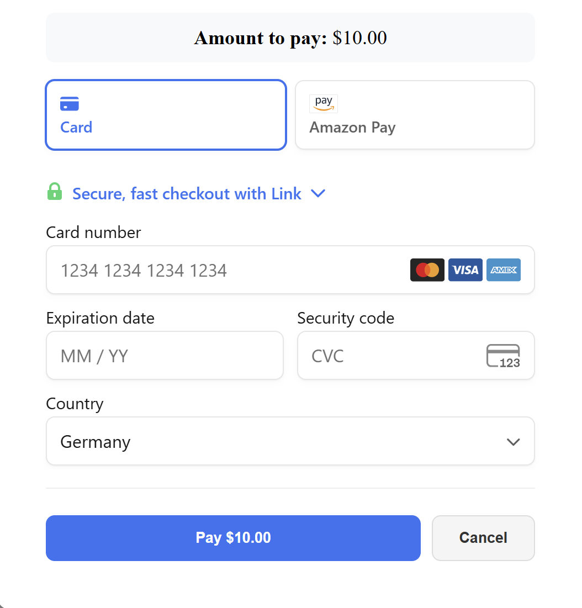

# Al-Ahly Club Management System

A comprehensive web-based platform designed for managing university club events, activities, and member engagement at the German University in Cairo (GUC). The system provides a centralized solution for organizing and managing diverse event types including workshops, trips, conferences, bazaars, and gym sessions, while facilitating seamless interaction between students, faculty, staff, vendors, and administrators.

## Motivation

The Al-Ahly Club Management System was created to address the fragmented nature of event management at university clubs. Before this platform, event organization involved manual registration processes, scattered communication channels, and limited visibility into upcoming activities. Students struggled to discover events, faculty lacked tools to manage workshop registrations, and vendors had no standardized way to participate in university bazaars.

This project was pursued to create a unified digital ecosystem that:
- **Streamlines Event Discovery**: Provides students with a centralized platform to browse, filter, and register for events
- **Empowers Event Organizers**: Gives professors and events office staff powerful tools to create, manage, and track events
- **Facilitates Vendor Participation**: Enables vendors to apply for bazaar participation with a structured approval workflow
- **Enhances Transparency**: Offers real-time registration tracking, payment management, and automated certificate generation
- **Improves User Experience**: Integrates modern payment solutions (Stripe), email notifications, and QR code-based attendance verification

The decision to build this system stems from the need to modernize university club operations, reduce administrative overhead, and create a more engaging experience for all stakeholders in the university community.

## Build Status

**Current Version:** 1.0.0  
**Status:** Active Development ✅

### Known Issues & Areas for Improvement

1. **Frontend Development Server Error**
   - **Issue**: Both frontend and backend development servers exit with code 1 on startup
   - **Impact**: Requires manual restart to resolve dependency conflicts
   - **Workaround**: Clear node_modules and reinstall dependencies, ensure environment variables are properly configured
   - **Status**: Under investigation

2. **Email Configuration Sensitivity**
   - **Issue**: Email verification system requires precise SMTP configuration
   - **Impact**: Registration email delivery may fail if Gmail App Passwords are not properly configured
   - **Workaround**: Follow `EMAIL_SETUP_GUIDE.md` for proper configuration
   - **Status**: Documentation provided, needs better error messaging

3. **Stripe Test Mode Limitations**
   - **Issue**: Payment system currently configured for Stripe test mode
   - **Impact**: Real transactions require switching to production keys
   - **Workaround**: Use test card numbers (4242 4242 4242 4242) for testing
   - **Status**: By design for development; production keys needed for deployment

4. **File Upload Size Limits**
   - **Issue**: Vendor document uploads limited to 5MB per file
   - **Impact**: Large PDF documents may be rejected
   - **Workaround**: Compress files before uploading
   - **Status**: Configurable in multer middleware, may increase limit in production

5. **Certificate Generation Performance**
   - **Issue**: QR code and PDF generation can be slow for large batches
   - **Impact**: Certificate downloads for events with 100+ attendees may timeout
   - **Workaround**: Consider implementing background job processing
   - **Status**: Planned optimization for Sprint 3

6. **Mobile Responsiveness**
   - **Issue**: Some admin dashboard tables are not fully optimized for mobile devices
   - **Impact**: Horizontal scrolling required on smaller screens
   - **Status**: UI improvements planned

7. **Search Functionality Limitations**
   - **Issue**: Event search only supports basic text matching on title and description
   - **Impact**: Users cannot search by date ranges or multiple criteria simultaneously
   - **Status**: Enhanced search features planned for future iterations

## Code Style

This project follows **JavaScript Standard Style** with ESLint configuration for Next.js:

- **Frontend**: Next.js ESLint configuration (`eslint-config-next`)
  - React best practices
  - Accessibility rules
  - Next.js specific optimizations
  - No semicolons (JavaScript Standard Style)
  
- **Backend**: ES6+ module syntax with consistent formatting
  - Camel case for variables and functions
  - Pascal case for model/schema names
  - Async/await for asynchronous operations
  - Proper error handling with try-catch blocks

**Code Formatting Guidelines:**
- 2-space indentation
- Single quotes for strings
- Trailing commas in multi-line objects/arrays
- Descriptive variable and function names
- JSDoc comments for complex functions

**File Naming Conventions:**
- Components: PascalCase (e.g., `PaymentModal.js`)
- Routes: camelCase (e.g., `eventRoutes.js`)
- Controllers: camelCase with Controller suffix (e.g., `authController.js`)
- Models: PascalCase (e.g., `User.js`, `Event.js`)

## Screenshots

### 1. Student Dashboard - Event Discovery
)
*Students can browse all upcoming events with filtering options by event type, date, and search functionality*

### 2. Event Registration & Payment Flow
 )
*Integrated Stripe payment system with wallet balance and credit card payment options for workshop and trip registrations*

### 3. Professor Workshop Management

*Professors can create workshops, view registrations, track payments, and download attendee lists*

### 4. Admin Events Office Dashboard
)
*Comprehensive admin panel for managing all events, viewing sales reports, approving vendor applications, and generating certificates*

### 5. Vendor Bazaar Application System
)
*Vendors can submit applications for bazaar events with staff details, booth requirements, and document uploads*
---

## Tech/Framework Used

### MERN Stack Architecture

This project is built on the **MERN stack** (MongoDB, Express.js, React, Node.js) with modern enhancements:

### Backend Technologies

| Technology | Version | Purpose |
|------------|---------|---------|
| **Node.js** | 18+ | Server-side JavaScript runtime environment |
| **Express.js** | ^4.18.2 | Web application framework for RESTful API development |
| **MongoDB** | Latest | NoSQL database for flexible document-based data storage |
| **Mongoose** | ^7.0.0 | ODM (Object Data Modeling) library for MongoDB |

### Frontend Technologies

| Technology | Version | Purpose |
|------------|---------|---------|
| **Next.js** | 14.2.13 | React framework with server-side rendering and routing |
| **React** | ^18.3.1 | Component-based UI library |
| **React DOM** | ^18.3.1 | DOM-specific methods for React |

### Payment Integration

| Technology | Version | Purpose |
|------------|---------|---------|
| **Stripe** | ^19.3.1 | Payment processing (both server & client) |
| **@stripe/stripe-js** | ^8.3.0 | Stripe.js loading utility |
| **@stripe/react-stripe-js** | ^5.3.0 | React components for Stripe Elements |

### Authentication & Security

| Technology | Version | Purpose |
|------------|---------|---------|
| **bcryptjs** | ^2.4.3 | Password hashing and verification |
| **jsonwebtoken** | ^9.0.0 | JWT-based authentication tokens |
| **validator** | ^13.9.0 | String validation and sanitization |
| **crypto** | ^1.0.1 | Cryptographic operations for token generation |

### Email System

| Technology | Version | Purpose |
|------------|---------|---------|
| **Nodemailer** | ^7.0.9 | Email sending (verification, receipts, certificates) |

### File Processing

| Technology | Version | Purpose |
|------------|---------|---------|
| **Multer** | ^1.4.5-lts.1 | File upload middleware for vendor documents |
| **PDFKit** | ^0.17.2 | PDF generation for certificates |
| **QRCode** | ^1.5.4 | QR code generation for attendance verification |
| **ExcelJS** | ^4.3.0 | Excel file generation for sales reports |

### Development Tools

| Technology | Version | Purpose |
|------------|---------|---------|
| **Nodemon** | ^3.1.11 | Auto-restart server on file changes (dev only) |
| **ESLint** | ^8.57.1 | Code linting and style enforcement |
| **CORS** | ^2.8.5 | Cross-Origin Resource Sharing middleware |
| **dotenv** | ^16.0.3 | Environment variable management |

### Additional Technologies

- **REST API Architecture**: Standard HTTP methods (GET, POST, PUT, PATCH, DELETE)
- **JWT Authentication**: Stateless token-based authentication
- **Role-Based Access Control (RBAC)**: Multi-level user permissions (Student, Staff, TA, Professor, Vendor, Admin, EventsOffice)
- **Middleware Pattern**: Custom authentication and authorization middleware
- **MVC Architecture**: Separation of concerns with Models, Controllers, and Routes

---

## Features

### 🎯 Core Event Management
1. **Multi-Type Event System**
   - Support for 5 event types: Workshops, Trips, Conferences, Bazaars, Gym Sessions
   - Role-based event visibility (restrict events to specific user roles)
   - Event creation, editing, archiving, and deletion
   - Real-time event status tracking (upcoming, completed, canceled)

2. **Workshop Management**
   - Professor-created workshops with approval workflow
   - Paid and free workshop options
   - Registration capacity management
   - Attendee tracking and exports

3. **Trip & Conference Organization**
   - EventsOffice-exclusive creation rights
   - Location and date management
   - Registration limits and waitlist functionality

4. **Bazaar & Vendor Management**
   - Vendor application system with approval workflow
   - Booth setup requirements and staff registration
   - Document upload for vendor verification
   - Multi-vendor event participation tracking

5. **Gym Session Scheduling**
   - Recurring session management
   - Capacity-based registration
   - Session time slot organization

### 👥 User Management & Authentication
6. **Multi-Role User System**
   - 7 distinct user roles: Student, Staff, TA, Professor, Vendor, Admin, EventsOffice
   - GUC email verification requirement (@guc.edu.eg)
   - Role-based admin approval for Staff, TA, and Professor accounts
   - Account status management (active/blocked)

7. **Secure Authentication**
   - JWT token-based authentication
   - Password hashing with bcrypt
   - Email verification system
   - Protected routes with middleware

### 💳 Payment System
8. **Dual Payment Methods**
   - Digital wallet system with balance tracking
   - Stripe credit card payment integration
   - Payment history and transaction logs
   - Automated payment receipts via email

9. **Financial Management**
   - Wallet top-up functionality
   - Payment status tracking (paid, pending, free)
   - Refund handling for cancellations
   - Sales report generation with Excel export

### 📊 Registration System
10. **Event Registration**
    - One-click registration with duplicate prevention
    - Registration cancellation with refund logic
    - Capacity enforcement
    - Registration status tracking

11. **Registration Tracking**
    - View all registered events per user
    - Professor dashboard for workshop registrations
    - Admin view of all system registrations
    - Export attendee lists to Excel

### 🎓 Certificate Generation
12. **Automated Certificate Issuance**
    - PDF certificate generation for completed workshops
    - QR code integration for verification
    - Batch certificate issuance for all attendees
    - Email delivery of certificates

13. **Certificate Management**
    - Unique certificate IDs
    - Download certificates as PDF
    - Certificate issuance tracking

### ⭐ User Engagement
14. **Rating System**
    - 5-star event rating (1-5 scale)
    - One rating per user per event
    - Average rating calculation
    - Rating modification and deletion

15. **Comment System**
    - Event-specific commenting
    - User comment management (edit/delete own comments)
    - Admin moderation capabilities
    - Comment deletion notifications via email

16. **Favorites System**
    - Bookmark favorite events
    - Quick access to saved events
    - Favorite status indicators

### 📧 Email Notification System
17. **Automated Email Workflows**
    - Email verification on signup
    - Payment receipts with event details
    - Certificate delivery
    - Comment deletion notifications
    - Role approval notifications

### 📈 Admin & Reporting
18. **Admin Dashboard**
    - System-wide event management
    - User approval workflow
    - Vendor application review
    - Sales and registration analytics

19. **Sales Reports**
    - Revenue tracking per event
    - Attendee count analysis
    - Payment method breakdown
    - Excel export for financial records

20. **Events Office Tools**
    - Create trips and conferences
    - Approve workshop submissions
    - View all event registrations
    - Export registration data

### 🔍 Search & Filtering
21. **Advanced Event Discovery**
    - Text search on event name and description
    - Filter by event type (workshop, trip, conference, bazaar, gym_session)
    - Filter by location
    - Filter by professor name
    - Date-based sorting (ascending/descending)

### 🔒 Security Features
22. **Data Protection**
    - Password encryption (bcrypt)
    - JWT authentication tokens
    - Protected API routes with middleware
    - Role-based authorization checks
    - Input validation and sanitization

### 📱 Development Features
23. **Development Mode**
    - Bypass email verification for testing
    - Non-GUC email support in dev mode
    - Test mode for Stripe payments
    - Detailed error logging

---

## Code Examples

### Example 1: User Registration with Email Verification

```javascript
// controllers/authController.js
export const signupUser = async (req, res) => {
  try {
    const { first_name, last_name, email, id_number, password, role } = req.body;

    // Validate GUC email domain
    const isDevelopment = process.env.DEVELOPMENT_MODE === 'true';
    if (!isDevelopment && !email.endsWith('@guc.edu.eg')) {
      return res.status(400).json({ 
        message: "Email must be a valid GUC email address" 
      });
    }

    // Check for existing user
    const userExists = await User.findOne({ email });
    if (userExists) return res.status(400).json({ message: "User already exists" });

    // Hash password with bcrypt
    const salt = await bcrypt.genSalt(10);
    const hash = await bcrypt.hash(password, salt);

    // Generate email verification token
    const verificationToken = generateVerificationToken();

    // Create new user
    const user = await User.create({
      first_name,
      last_name,
      email,
      id_number,
      password_hash: hash,
      role,
      email_verification_token: verificationToken,
      email_verified: false,
      role_admin_verified: false
    });

    // Send verification email
    await sendVerificationEmail(email, verificationToken);

    res.status(201).json({ 
      message: "User created successfully. Please check your email to verify your account.",
      userId: user._id 
    });
  } catch (err) {
    res.status(500).json({ message: err.message });
  }
};
```

### Example 2: Stripe Payment Integration with Wallet Fallback

```javascript
// controllers/paymentController.js
export const payWithWallet = async (req, res) => {
  try {
    const { registrationId } = req.body;

    // Get registration with populated event
    const registration = await Registration.findById(registrationId)
      .populate('event_id');

    if (!registration) {
      return res.status(404).json({ message: "Registration not found" });
    }

    // Calculate payment amount
    const amount = registration.event_id.type === 'Workshop' 
      ? registration.event_id.workshop.fees 
      : registration.event_id.trip.price;

    // Get user wallet
    const user = await User.findById(req.user._id);
    
    if (!user.wallet || user.wallet.balance < amount) {
      return res.status(400).json({ 
        message: "Insufficient wallet balance",
        currentBalance: user.wallet?.balance || 0,
        required: amount
      });
    }

    // Deduct from wallet
    user.wallet.balance -= amount;
    user.wallet.transactions.push({
      type: 'payment',
      amount: -amount,
      description: `Payment for ${registration.event_id.name}`,
      registration_id: registrationId,
      timestamp: new Date()
    });

    await user.save();

    // Update registration payment status
    registration.payment_status = 'paid';
    registration.payment_method = 'wallet';
    await registration.save();

    // Send payment receipt
    await sendPaymentReceipt(user.email, registration, amount);

    res.json({
      success: true,
      message: "Payment successful",
      newBalance: user.wallet.balance
    });
  } catch (err) {
    res.status(500).json({ message: err.message });
  }
};
```

### Example 3: Event Filtering with Role-Based Access Control

```javascript
// controllers/eventController.js
export const getUpcomingEvents = async (req, res) => {
  try {
    const userRole = req.user?.role;
    
    // Query upcoming events with workshop approval filter
    let events = await Event.find({
      status: "upcoming",
      start_date: { $gt: new Date() },
      $or: [
        { type: { $ne: "Workshop" } },
        { type: "Workshop", "workshop.approval_status": "accepted" }
      ]
    })
    .populate('bazaar.vendors_participating.vendor_id', 'first_name last_name email')
    .sort({ start_date: 1 });
    
    // Filter events based on role restrictions
    if (userRole !== 'Admin' && userRole !== 'EventsOffice') {
      events = events.filter(event => {
        // If no role restrictions, allow all
        if (!event.allowed_roles || event.allowed_roles.length === 0) {
          return true;
        }
        // Check if user's role is in allowed list
        return event.allowed_roles.includes(userRole);
      });
    }
    
    res.status(200).json(events);
  } catch (err) {
    console.error(err);
    res.status(500).json({ error: "Server error" });
  }
};
```

### Example 4: PDF Certificate Generation with QR Code

```javascript
// controllers/certificateController.js
export const issueCertificate = async (req, res) => {
  try {
    const { registrationId } = req.params;

    // Get registration with populated event and user
    const registration = await Registration.findById(registrationId)
      .populate('event_id')
      .populate('user_id');

    if (!registration) {
      return res.status(404).json({ message: "Registration not found" });
    }

    // Verify workshop is completed
    if (registration.event_id.status !== 'completed') {
      return res.status(400).json({ 
        message: "Cannot issue certificate - workshop is not yet completed" 
      });
    }

    // Prepare certificate data
    const certificateData = {
      userName: `${registration.user_id.first_name} ${registration.user_id.last_name}`,
      workshopName: registration.event_id.name,
      workshopDate: formatCertificateDate(registration.event_id.start_date),
      issueDate: formatCertificateDate(new Date()),
      certificateId: `CERT-${registration._id.toString().slice(-8).toUpperCase()}`
    };

    // Generate PDF certificate with QR code
    const pdfBuffer = await generateCertificate(certificateData);

    // Send certificate via email
    await sendCertificateEmail(
      registration.user_id.email,
      certificateData,
      pdfBuffer
    );

    res.json({
      success: true,
      message: "Certificate issued and sent via email successfully",
      certificateData
    });
  } catch (error) {
    console.error('Certificate issuance error:', error);
    res.status(500).json({ message: "Failed to issue certificate" });
  }
};
```

### Example 5: JWT Authentication Middleware

```javascript
// middleware/auth.js
export const auth = (req, res, next) => {
  try {
    // Get token from header
    const token = req.header('Authorization')?.replace('Bearer ', '');

    if (!token) {
      return res.status(401).json({ message: 'No authentication token, access denied' });
    }

    // Verify token
    const decoded = jwt.verify(token, process.env.JWT_SECRET);
    
    // Attach user to request
    req.user = decoded;
    next();
  } catch (err) {
    res.status(401).json({ message: 'Token verification failed, authorization denied' });
  }
};

// Role-based authorization middleware
export const requireAdmin = (req, res, next) => {
  if (req.user.role !== 'Admin') {
    return res.status(403).json({ message: 'Access denied. Admin role required.' });
  }
  next();
};

export const requireAdminOrEventsOffice = (req, res, next) => {
  if (req.user.role !== 'Admin' && req.user.role !== 'EventsOffice') {
    return res.status(403).json({ 
      message: 'Access denied. Admin or EventsOffice role required.' 
    });
  }
  next();
};
```

---

## API References

The backend provides a comprehensive RESTful API with the following main endpoints:

### Authentication Routes (`/api/auth`)

| Method | Endpoint | Description | Auth Required | Role Required |
|--------|----------|-------------|---------------|---------------|
| POST | `/signup` | Register new user account | No | None |
| POST | `/login` | Login and receive JWT token | No | None |
| POST | `/logout` | Logout user | No | None |
| POST | `/create-first-admin` | Create initial admin account | No | None |

**Example Request:**
```javascript
POST /api/auth/signup
Content-Type: application/json

{
  "first_name": "John",
  "last_name": "Doe",
  "email": "john.doe@guc.edu.eg",
  "id_number": "12345678",
  "password": "securePassword123",
  "role": "Student"
}
```

**Example Response:**
```json
{
  "message": "User created successfully. Please check your email to verify your account.",
  "userId": "507f1f77bcf86cd799439011"
}
```

---

### Event Routes (`/api/events`)

| Method | Endpoint | Description | Auth Required | Role Required |
|--------|----------|-------------|---------------|---------------|
| GET | `/all` | Get all events | Yes | Admin/EventsOffice |
| GET | `/upcoming` | Get upcoming events | Yes | Student+ |
| GET | `/filter/:field/:value` | Filter events by field | Yes | Student+ |
| GET | `/sort/date/:order` | Sort events by date | Yes | Student+ |
| GET | `/:id` | Get event by ID | Yes | Student+ |
| GET | `/:eventId/ratings` | Get event ratings | Yes | Student+ |
| GET | `/:eventId/my-rating` | Get user's rating for event | Yes | Student+ |
| POST | `/:eventId/rate` | Rate an event (1-5 stars) | Yes | Student+ |
| DELETE | `/:eventId/rate` | Delete user's rating | Yes | Student+ |
| GET | `/:event_id/comments` | Get event comments | Yes | Student+ |
| GET | `/:eventId/my-comment` | Get user's comment | Yes | Student+ |
| POST | `/:eventId/comments` | Create comment on event | Yes | Student+ |
| PUT | `/:eventId/comments/:commentId` | Update user's comment | Yes | Student+ |
| DELETE | `/:eventId/comments/:commentId` | Delete user's comment | Yes | Student+ |
| DELETE | `/delete/:eventId` | Delete event | Yes | Admin/EventsOffice |
| PATCH | `/archive/:eventId` | Archive event | Yes | Admin/EventsOffice |
| PATCH | `/unarchive/:eventId` | Unarchive event | Yes | Admin/EventsOffice |

**Example Request:**
```javascript
GET /api/events/upcoming
Authorization: Bearer <JWT_TOKEN>
```

**Example Response:**
```json
[
  {
    "_id": "507f1f77bcf86cd799439011",
    "name": "Machine Learning Workshop",
    "type": "Workshop",
    "location": "Building D5, Room 201",
    "start_date": "2025-12-15T10:00:00.000Z",
    "end_date": "2025-12-15T14:00:00.000Z",
    "status": "upcoming",
    "workshop": {
      "fees": 50,
      "professor_id": "507f191e810c19729de860ea",
      "professor_name": "Dr. Ahmed Hassan",
      "approval_status": "accepted"
    },
    "max_capacity": 30,
    "registration_count": 15
  }
]
```

---

### Registration Routes (`/api/registrations`)

| Method | Endpoint | Description | Auth Required | Role Required |
|--------|----------|-------------|---------------|---------------|
| POST | `/register` | Register for an event | Yes | Student/Staff/TA/Professor |
| GET | `/:user_id/events` | Get user's registered events | Yes | Student/Staff/TA/Professor |
| GET | `/my-events` | Get registrations for professor's events | Yes | Admin/EventsOffice |
| PATCH | `/cancel/:registrationId` | Cancel registration with refund | Yes | Student/Staff/TA/Professor |
| DELETE | `/cancel-unpaid/:registrationId` | Cancel unpaid registration | Yes | Student/Staff/TA/Professor |
| GET | `/all` | Get all registrations (admin) | Yes | Admin |
| GET | `/event/:event_id/export` | Export registrations to Excel | Yes | Admin/EventsOffice |

**Example Request:**
```javascript
POST /api/registrations/register
Authorization: Bearer <JWT_TOKEN>
Content-Type: application/json

{
  "event_id": "507f1f77bcf86cd799439011",
  "user_id": "507f191e810c19729de860ea"
}
```

---

### Payment Routes (`/api/payments`)

| Method | Endpoint | Description | Auth Required | Role Required |
|--------|----------|-------------|---------------|---------------|
| GET | `/wallet/balance` | Get user wallet balance | Yes | Student/Staff/TA/Professor |
| POST | `/wallet/top-up` | Top up wallet balance | Yes | Student/Staff/TA/Professor |
| GET | `/wallet/transactions` | Get wallet transaction history | Yes | Student/Staff/TA/Professor |
| POST | `/wallet/pay` | Pay for event with wallet | Yes | Student/Staff/TA/Professor |
| POST | `/stripe/create-intent` | Create Stripe payment intent | Yes | Student/Staff/TA/Professor |
| POST | `/stripe/confirm` | Confirm Stripe payment | Yes | Student/Staff/TA/Professor |
| GET | `/history` | Get payment history | Yes | Student/Staff/TA/Professor |

**Example Request:**
```javascript
POST /api/payments/wallet/pay
Authorization: Bearer <JWT_TOKEN>
Content-Type: application/json

{
  "registrationId": "507f1f77bcf86cd799439011"
}
```

**Example Response:**
```json
{
  "success": true,
  "message": "Payment successful",
  "newBalance": 150.00
}
```

---

### Workshop Routes (`/api/workshops`)

| Method | Endpoint | Description | Auth Required | Role Required |
|--------|----------|-------------|---------------|---------------|
| POST | `/` | Create new workshop | Yes | Professor |
| GET | `/pending` | Get pending workshop approvals | Yes | Admin/EventsOffice |
| GET | `/my` | Get professor's workshops | Yes | Professor |
| GET | `/:id/participants` | Get workshop participants | Yes | Professor |
| PUT | `/:id` | Edit workshop details | Yes | Professor |
| PATCH | `/:id/review` | Approve/reject workshop | Yes | Admin/EventsOffice |
| PATCH | `/:id/complete` | Mark workshop as completed | Yes | Admin/EventsOffice |

**Example Request:**
```javascript
POST /api/workshops
Authorization: Bearer <JWT_TOKEN>
Content-Type: application/json

{
  "name": "Introduction to React",
  "description": "Learn React fundamentals",
  "location": "Building D5",
  "start_date": "2025-12-20T10:00:00Z",
  "end_date": "2025-12-20T14:00:00Z",
  "fees": 75,
  "max_capacity": 25
}
```

---

### Vendor Routes (`/api/vendor`)

| Method | Endpoint | Description | Auth Required | Role Required |
|--------|----------|-------------|---------------|---------------|
| GET | `/upcoming/bazaars` | Get upcoming bazaar events | Yes | Vendor |
| POST | `/apply/bazaar` | Apply to participate in bazaar | Yes | Vendor |
| POST | `/apply/booth-event` | Apply for booth event | Yes | Vendor |
| GET | `/applications/my-applications` | Get vendor's applications | Yes | Vendor |
| GET | `/applications/accepted` | Get accepted applications | Yes | Vendor |
| GET | `/applications/pending-rejected` | Get pending/rejected applications | Yes | Vendor |
| PATCH | `/applications/:applicationId/cancel` | Cancel vendor application | Yes | Vendor |
| POST | `/pay/wallet` | Pay application fee with wallet | Yes | Vendor |
| POST | `/pay/stripe/create` | Create Stripe payment for vendor | Yes | Vendor |
| POST | `/pay/stripe/confirm` | Confirm vendor Stripe payment | Yes | Vendor |

---

### Certificate Routes (`/api/certificates`)

| Method | Endpoint | Description | Auth Required | Role Required |
|--------|----------|-------------|---------------|---------------|
| POST | `/issue/:registrationId` | Issue certificate for workshop | Yes | Admin/EventsOffice |
| POST | `/batch-issue/:eventId` | Batch issue certificates for event | Yes | Admin/EventsOffice |

**Example Request:**
```javascript
POST /api/certificates/issue/507f1f77bcf86cd799439011
Authorization: Bearer <JWT_TOKEN>
```

**Example Response:**
```json
{
  "success": true,
  "message": "Certificate issued and sent via email successfully",
  "certificateData": {
    "userName": "John Doe",
    "workshopName": "Machine Learning Workshop",
    "certificateId": "CERT-CD799439",
    "email": "john.doe@guc.edu.eg"
  }
}
```

---

## Tests

### Postman Test Collection

The following tests were performed using Postman to validate API functionality:

#### Test 1: User Registration Flow

**Test Name:** `POST /api/auth/signup - Create Student Account`

**Request:**
```http
POST http://localhost:5001/api/auth/signup
Content-Type: application/json

{
  "first_name": "Sarah",
  "last_name": "Ahmed",
  "email": "sarah.ahmed@guc.edu.eg",
  "id_number": "87654321",
  "password": "TestPassword123!",
  "role": "Student"
}
```

**Expected Result:** 
- Status Code: `201 Created`
- Response includes `userId` and success message
- Verification email sent to user

**Screenshot:**
)

---

#### Test 2: User Login and JWT Token

**Test Name:** `POST /api/auth/login - Authenticate User`

**Request:**
```http
POST http://localhost:5001/api/auth/login
Content-Type: application/json

{
  "email": "sarah.ahmed@guc.edu.eg",
  "password": "TestPassword123!"
}
```

**Expected Result:**
- Status Code: `200 OK`
- Response includes JWT token and user details

**Postman Test Script:**
```javascript
pm.test("Status code is 200", function () {
    pm.response.to.have.status(200);
});

pm.test("Response has token", function () {
    var jsonData = pm.response.json();
    pm.expect(jsonData).to.have.property('token');
    pm.environment.set("jwt_token", jsonData.token);
});
```

**Screenshot:**
)

---

#### Test 3: Get Upcoming Events (Protected Route)

**Test Name:** `GET /api/events/upcoming - Fetch Events with Auth`

**Request:**
```http
GET http://localhost:5001/api/events/upcoming
Authorization: Bearer {{jwt_token}}
```

**Expected Result:**
- Status Code: `200 OK`
- Returns array of upcoming events
- Only shows events where user role is allowed

**Postman Test Script:**
```javascript
pm.test("Status code is 200", function () {
    pm.response.to.have.status(200);
});

pm.test("Response is an array", function () {
    var jsonData = pm.response.json();
    pm.expect(jsonData).to.be.an('array');
});

pm.test("Events have required fields", function () {
    var jsonData = pm.response.json();
    if (jsonData.length > 0) {
        pm.expect(jsonData[0]).to.have.property('name');
        pm.expect(jsonData[0]).to.have.property('type');
        pm.expect(jsonData[0]).to.have.property('start_date');
    }
});
```

**Screenshot:**
)

---

#### Test 4: Get User's Registered Events

**Test Name:** `GET /api/registration/:user_id/events - View My Registrations`

**Request:**
```http
GET http://localhost:5001/api/registration/{{user_id}}/events
Authorization: Bearer {{jwt_token}}
```

**Note:** Replace `{{user_id}}` with your actual user ID from the login response.

**Expected Result:**
- Status Code: `200 OK`
- Returns array of events the user is registered for
- Each registration includes event details and payment status

**Postman Test Script:**
```javascript
pm.test("Status code is 200", function () {
    pm.response.to.have.status(200);
});

pm.test("Response is an array", function () {
    var jsonData = pm.response.json();
    pm.expect(jsonData).to.be.an('array');
});

pm.test("Registrations have required fields", function () {
    var jsonData = pm.response.json();
    if (jsonData.length > 0) {
        pm.expect(jsonData[0]).to.have.property('event_id');
        pm.expect(jsonData[0]).to.have.property('payment_status');
        pm.expect(jsonData[0]).to.have.property('registration_date');
    }
});
```

**Screenshot:**
)

---

#### Test 5: Create Workshop (Professor)

**Test Name:** `POST /api/workshops - Create New Workshop`

**Request:**
```http
POST http://localhost:5001/api/workshop
Authorization: Bearer {{professor_jwt_token}}
Content-Type: application/json

{
  "name": "Advanced Database Design",
  "description": "Learn advanced SQL and NoSQL concepts",
  "location": "Building H2, Room 304",
  "start_date": "2025-12-25T09:00:00Z",
  "end_date": "2025-12-25T13:00:00Z",
  "fees": 100,
  "max_capacity": 20
}
```

---

**Expected Result:**
- Status Code: `201 Created`
- Workshop created with `pending` approval status
- Professor ID automatically assigned

**Screenshot:**
)


## Installation

### Prerequisites

Before installing the Al-Ahly Club Management System, ensure you have the following installed:

- **Node.js** (v18.0.0 or higher) - [Download Node.js](https://nodejs.org/)
- **MongoDB** (v5.0 or higher) - [Install MongoDB](https://www.mongodb.com/try/download/community)
- **npm** or **yarn** package manager (comes with Node.js)
- **Git** - [Download Git](https://git-scm.com/)
- **Stripe Account** (for payment processing) - [Sign up for Stripe](https://stripe.com/)
- **Gmail Account** (for email notifications with App Password enabled)

### Step 1: Clone the Repository

```bash
git clone https://github.com/nooreldeenamir/Al-Ahly.git
cd Al-Ahly
```

### Step 2: Backend Setup

#### 2.1 Navigate to Backend Directory
```bash
cd backend
```

#### 2.2 Install Backend Dependencies
```bash
npm install
```

#### 2.3 Configure Environment Variables

Create a `.env` file in the `backend` directory with the following configuration:

```env
# Database Configuration
MONGO_URI=mongodb://localhost:27017/al-ahly-club

# JWT Secret (generate a secure random string)
JWT_SECRET=your_super_secret_jwt_key_here_change_this

# Server Port
PORT=5001

# Development Mode (set to 'true' for development, 'false' for production)
DEVELOPMENT_MODE=true
NODE_ENV=development

# Email Configuration (Gmail)
EMAIL_USER=your-email@gmail.com
EMAIL_PASS=your-gmail-app-password

# Stripe Configuration
STRIPE_SECRET_KEY=sk_test_your_stripe_test_key_here
STRIPE_PUBLISHABLE_KEY=pk_test_your_stripe_publishable_key_here

# Email Verification (optional - skip in development)
SKIP_EMAIL_VERIFICATION=true

# Frontend URL (for CORS)
FRONTEND_URL=http://localhost:3000
```

**Important Notes:**
- Replace `your-email@gmail.com` with your actual Gmail address
- Generate a Gmail App Password (see `EMAIL_SETUP_GUIDE.md`)
- Get Stripe keys from your [Stripe Dashboard](https://dashboard.stripe.com/test/apikeys)
- Never commit `.env` file to version control

#### 2.4 Start MongoDB

Ensure MongoDB is running on your system:

**Windows:**
```bash
mongod
```

**macOS/Linux:**
```bash
sudo systemctl start mongod
```

#### 2.5 Seed Sample Data (Optional)

To populate the database with sample events and users:

```bash
node seed-sample-data.js
```

#### 2.6 Create Admin Account

```bash
node create-admin-accounts.js
```

Default admin credentials:
- **Email:** `admin@guc.edu.eg`
- **Password:** `Admin123!`

#### 2.7 Start Backend Server

To run the project temporarily without MongoDB, enable the database bypass in PowerShell:

```powershell
$env:DATABASE_DISABLED = "true"
npm run dev
```

In this mode, the backend starts without connecting to MongoDB, database-backed API requests return `503`, and database-dependent background jobs are not started. The frontend can still be opened, but features that need the API will be unavailable. Close the terminal or set `$env:DATABASE_DISABLED = "false"` to restore normal database startup.

For normal operation, start the backend without setting `DATABASE_DISABLED`:

```bash
npm run dev
```

The backend server will run on `http://localhost:5001`

---

### Step 3: Frontend Setup

#### 3.1 Navigate to Frontend Directory

Open a new terminal window:

```bash
cd frontend
```

#### 3.2 Install Frontend Dependencies

```bash
npm install
```

#### 3.3 Configure Frontend Environment

Create a `.env.local` file in the `frontend` directory:

```env
NEXT_PUBLIC_API_URL=http://localhost:5001/api
NEXT_PUBLIC_STRIPE_PUBLISHABLE_KEY=pk_test_your_stripe_publishable_key_here
```

#### 3.4 Start Frontend Development Server

```bash
npm run dev
```

The frontend will run on `http://localhost:3000`

---

### Step 4: Verify Installation

1. **Open Browser:** Navigate to `http://localhost:3000`
2. **Test Registration:** Create a new student account
3. **Check Email:** Verify that verification email was received
4. **Test Login:** Login with your new account
5. **Browse Events:** View upcoming events on the dashboard

---

### Troubleshooting

**Issue:** Backend exits with code 1
- **Solution:** Check MongoDB is running and `.env` file is properly configured

**Issue:** Email verification not sending
- **Solution:** Verify Gmail App Password in `.env` or set `SKIP_EMAIL_VERIFICATION=true`

**Issue:** Stripe payments failing
- **Solution:** Ensure you're using test keys and test card number `4242 4242 4242 4242`

**Issue:** Port already in use
- **Solution:** Change `PORT` in backend `.env` or kill process using the port

---

## How to Use?

### For Students

#### 1. Account Registration
1. Navigate to `http://localhost:3000`
2. Click **"Sign Up"**
3. Fill in your details (must use `@guc.edu.eg` email in production)
4. Check your email for verification link
5. Click the verification link to activate your account

#### 2. Browse Events
1. Login to your account
2. View upcoming events on the **Dashboard**
3. Use filters to find specific event types (Workshops, Trips, Conferences)
4. Click on an event to view full details

#### 3. Register for Events
1. Click **"Register"** on an event card
2. For paid events, you'll see the payment modal
3. Choose payment method:
   - **Wallet**: If you have sufficient balance
   - **Credit Card**: Enter card details (use `4242 4242 4242 4242` for testing)
4. Confirm payment
5. Receive payment receipt via email

#### 4. Manage Registrations
1. Navigate to **"My Events"**
2. View all your registered events
3. Cancel registrations if needed (refund processed automatically)
4. Download certificates for completed workshops

---

### For Professors

#### 1. Create Workshop
1. Login with Professor account
2. Navigate to **"Create Workshop"**
3. Fill in workshop details:
   - Name, Description, Location
   - Start and End Date/Time
   - Workshop fees (or set to 0 for free)
   - Maximum capacity
4. Submit for approval
5. Wait for Admin/EventsOffice approval

#### 2. Manage Workshop Registrations
1. Go to **"My Workshops"**
2. View list of your workshops
3. Click on a workshop to see:
   - Registered participants
   - Payment status
   - Attendance tracking
4. Export participant list to Excel

#### 3. Complete Workshop
1. After workshop is finished, mark it as **"Completed"**
2. Certificates are automatically generated
3. Participants receive certificates via email

---

### For Vendors

#### 1. Apply for Bazaar
1. Login with Vendor account
2. Navigate to **"Upcoming Bazaars"**
3. Click **"Apply"** on a bazaar
4. Fill in application details:
   - Staff list (name and email for each)
   - Booth size requirements
   - Setup duration needed
5. Upload required documents
6. Pay application fee
7. Wait for admin approval

#### 2. Track Applications
1. View **"My Applications"**
2. Check application status:
   - **Pending**: Under review
   - **Accepted**: Approved for participation
   - **Rejected**: Not approved
3. Receive QR codes for staff members via email

---

### For Admin/EventsOffice

#### 1. Approve User Accounts
1. Navigate to **"Pending Approvals"**
2. Review Staff, TA, and Professor registration requests
3. Approve or reject based on verification

#### 2. Manage Events
1. View all events in the system
2. Create Trips and Conferences
3. Approve or reject Workshop submissions
4. Archive completed events
5. Delete canceled events

#### 3. Review Vendor Applications
1. Go to **"Vendor Applications"**
2. Review vendor application details
3. Check uploaded documents
4. Approve or reject applications

#### 4. Generate Reports
1. Navigate to **"Sales Reports"**
2. Select event and date range
3. View revenue and registration statistics
4. Export data to Excel for analysis

#### 5. Issue Certificates
1. Go to completed workshop
2. Click **"Issue Certificates"**
3. Choose:
   - Issue individual certificate
   - Batch issue for all attendees
4. Certificates sent automatically via email

---

## Contribute

We welcome contributions from the community! The Al-Ahly Club Management System is continuously evolving, and there are several areas where improvements can be made.

### How to Contribute

1. **Fork the Repository**
   ```bash
   git fork https://github.com/nooreldeenamir/Al-Ahly.git
   ```

2. **Create a Feature Branch**
   ```bash
   git checkout -b feature/your-feature-name
   ```

3. **Make Your Changes**
   - Follow the existing code style
   - Add comments for complex logic
   - Test your changes thoroughly

4. **Commit Your Changes**
   ```bash
   git commit -m "Add: Brief description of your feature"
   ```

5. **Push to Your Fork**
   ```bash
   git push origin feature/your-feature-name
   ```

6. **Submit a Pull Request**
   - Describe what your changes do
   - Reference any related issues
   - Include screenshots for UI changes

### Areas for Contribution

#### 🐛 Bug Fixes
- Fix development server startup issues
- Resolve mobile responsiveness problems
- Improve error handling and validation

#### ✨ Feature Enhancements
- Implement advanced search with multiple criteria and date ranges
- Add real-time notifications using WebSockets
- Create analytics dashboard for event organizers
- Develop mobile application (React Native)
- Add social media sharing for events

#### 📊 Performance Improvements
- Optimize certificate generation for large batches
- Implement caching for frequently accessed data
- Add database indexing for faster queries
- Reduce bundle size for faster page loads

#### 🎨 UI/UX Improvements
- Enhance mobile responsiveness across all pages
- Add dark mode support
- Improve accessibility (ARIA labels, keyboard navigation)
- Create interactive onboarding tutorials

#### 📝 Documentation
- Add JSDoc comments to all functions
- Create video tutorials for common workflows
- Translate documentation to Arabic
- Document API endpoints in detail (OpenAPI/Swagger)

#### 🧪 Testing
- Write unit tests for controllers (Jest)
- Add integration tests for API endpoints
- Implement E2E tests (Cypress/Playwright)
- Increase test coverage above 80%

### Code of Conduct

- Be respectful and constructive in discussions
- Follow the existing code style and conventions
- Write clear commit messages
- Test your code before submitting PR
- Update documentation when adding features

---

## Credits

This project was built with the help of various resources, tools, and inspirations:

### Development Resources

- **MongoDB Documentation**: [https://docs.mongodb.com/](https://docs.mongodb.com/) - Database design and query optimization
- **Express.js Guide**: [https://expressjs.com/](https://expressjs.com/) - RESTful API development
- **React Documentation**: [https://react.dev/](https://react.dev/) - Component architecture and hooks
- **Next.js Documentation**: [https://nextjs.org/docs](https://nextjs.org/docs) - Server-side rendering and routing
- **Stripe API Documentation**: [https://stripe.com/docs/api](https://stripe.com/docs/api) - Payment integration
- **Nodemailer Guide**: [https://nodemailer.com/](https://nodemailer.com/) - Email service implementation

### YouTube Tutorials

- **"MERN Stack Tutorial" by Traversy Media**: [https://www.youtube.com/watch?v=fnpmR6Q5lEc](https://www.youtube.com/watch?v=fnpmR6Q5lEc) - Full-stack development fundamentals
- **"Stripe Payment Integration" by Web Dev Simplified**: Payment processing implementation guidance
- **"JWT Authentication in Node.js" by The Net Ninja**: Authentication system architecture
- **"Next.js 14 Full Course" by JavaScript Mastery**: Frontend framework best practices
- **"MongoDB Aggregation Pipeline" by Academind**: Complex query operations

### Open Source Projects

- **Postman Echo**: [https://github.com/postmanlabs/postman-echo](https://github.com/postmanlabs/postman-echo) - API testing inspiration
- **Node.js Best Practices**: [https://github.com/goldbergyoni/nodebestpractices](https://github.com/goldbergyoni/nodebestpractices) - Code quality and security
- **Awesome Node.js**: [https://github.com/sindresorhus/awesome-nodejs](https://github.com/sindresorhus/awesome-nodejs) - Package discovery

### Stack Overflow Contributions

- Numerous solutions for debugging JWT authentication issues
- Email sending troubleshooting with Nodemailer
- Stripe webhook handling and payment confirmation
- MongoDB aggregation pipeline queries
- File upload handling with Multer

### Design Inspiration

- **Dribbble**: Event management dashboard UI/UX inspiration
- **Behance**: Color schemes and layout design for student portals

### Libraries & Dependencies

Special thanks to all the open-source maintainers of the packages used in this project (full list in `package.json`):
- bcryptjs, jsonwebtoken, mongoose, express, react, next, stripe, nodemailer, pdfkit, qrcode, exceljs, multer, validator, cors, dotenv

### Team Members

- **Development Team**: German University in Cairo Students
- **Project Advisors**: GUC Faculty Members
- **Testing Support**: Al-Ahly Club Members

---

## License

This project uses the following licenses:

### Main Project License

**ISC License**

Copyright (c) 2025 Al-Ahly Club Management System

Permission to use, copy, modify, and/or distribute this software for any purpose with or without fee is hereby granted, provided that the above copyright notice and this permission notice appear in all copies.

THE SOFTWARE IS PROVIDED "AS IS" AND THE AUTHOR DISCLAIMS ALL WARRANTIES WITH REGARD TO THIS SOFTWARE INCLUDING ALL IMPLIED WARRANTIES OF MERCHANTABILITY AND FITNESS. IN NO EVENT SHALL THE AUTHOR BE LIABLE FOR ANY SPECIAL, DIRECT, INDIRECT, OR CONSEQUENTIAL DAMAGES OR ANY DAMAGES WHATSOEVER RESULTING FROM LOSS OF USE, DATA OR PROFITS, WHETHER IN AN ACTION OF CONTRACT, NEGLIGENCE OR OTHER TORTIOUS ACTION, ARISING OUT OF OR IN CONNECTION WITH THE USE OR PERFORMANCE OF THIS SOFTWARE.

---

### Third-Party Licenses

This project incorporates several third-party libraries, each with their own licenses:

#### Stripe - Apache 2.0 License

The Stripe API library (`stripe`, `@stripe/stripe-js`, `@stripe/react-stripe-js`) is licensed under the Apache License 2.0.

**Key Terms:**
- Commercial use allowed
- Modification and distribution permitted
- Patent grant included
- Must include license and copyright notice

Full license: [https://www.apache.org/licenses/LICENSE-2.0](https://www.apache.org/licenses/LICENSE-2.0)

#### React & Next.js - MIT License

React and Next.js are licensed under the MIT License, which is permissive and allows commercial use.

#### MongoDB Node.js Driver - Apache 2.0 License

The MongoDB driver and Mongoose ODM are licensed under Apache 2.0.

#### Other Dependencies

All other npm packages used in this project are licensed under their respective open-source licenses (primarily MIT and Apache 2.0). Refer to individual `node_modules/[package]/LICENSE` files for specific terms.

---

### Compliance Notes

- **Stripe Integration**: This project uses Stripe's payment processing API. By using this software with Stripe, you agree to comply with [Stripe's Terms of Service](https://stripe.com/legal) and applicable payment processing regulations.
- **Email Services**: Gmail/SMTP usage must comply with Google's Terms of Service and anti-spam regulations.
- **Data Protection**: When deploying this system, ensure compliance with GDPR, CCPA, or other applicable data protection regulations.

---

### Disclaimer

This software is provided for educational and organizational purposes. The authors and contributors are not responsible for any misuse, data loss, or legal issues arising from the deployment or use of this system. Always review and comply with applicable laws and regulations in your jurisdiction before deploying payment processing or user data management systems.

---

**End of README**

---

## Quick Reference Links

- **GitHub Repository**: [https://github.com/nooreldeenamir/Al-Ahly](https://github.com/nooreldeenamir/Al-Ahly)
- **Issue Tracker**: [https://github.com/nooreldeenamir/Al-Ahly/issues](https://github.com/nooreldeenamir/Al-Ahly/issues)
- **Email Setup Guide**: See `EMAIL_SETUP_GUIDE.md`
- **Payment System Guide**: See `PAYMENT_SYSTEM_GUIDE.md`
- **Stripe Setup**: See `STRIPE_SETUP_GUIDE.md`
- **Certificate System**: See `HOW_CERTIFICATES_WORK.md`

---

**Version:** 1.0.0  
**Last Updated:** November 29, 2025  
**Maintained By:** Al-Ahly Club Development Team
